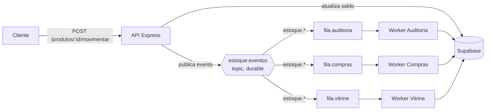

# Estoque Eventos — API orientada a eventos (Express + Supabase + RabbitMQ)

A rota de movimentação de estoque atualiza o saldo, publica um evento no RabbitMQ e responde `200 OK`
imediatamente. Três workers independentes consomem o evento: auditoria (kardex), alerta de compras e vitrine.
Se um worker cair ou ficar lento, a API continua normal e as mensagens esperam na fila.

## Arquitetura



## Estrutura

```
index.js                 API Express (produtor)
config/database.js       cliente Supabase
controllers/ rotas/      CRUD, auth e rota /movimentar
messaging/               topologia (exchange/filas) e publisher
workers/                 auditoria.js, compras.js, vitrine.js (+ base.js)
sql/                     DDL executado no Supabase
scripts/                 script da demonstração de resiliência
docker-compose.yml       RabbitMQ com painel (porta 15672)
.env.example             variáveis de ambiente
```

## Pré-requisitos
Node.js 18+, Docker e uma conta no Supabase.

## Passo a passo

### 1. Banco (Supabase)
1. Abra o projeto no Supabase > **SQL Editor** > **New query**.
2. Cole e execute `sql/01_schema.sql` (altera `produtos` e cria `movimentacoes_estoque` e `alertas_reposicao`).
3. (Opcional) Execute `sql/02_seed_exemplo.sql` para criar um produto de teste.
4. Em **Project Settings > API**, copie a **Project URL** e a chave **service_role**.

### 2. Variáveis de ambiente
```bash
cp .env.example .env
# edite .env com SUPABASE_URL, SUPABASE_KEY (service_role) e RABBITMQ_URL
```
> O `.env` está no `.gitignore`. Nunca suba a chave para o GitHub.

### 3. RabbitMQ
```bash
docker compose up -d
```
Painel: http://localhost:15672 (usuário `guest`, senha `guest`).

### 4. Instalar e subir (4 terminais)
```bash
npm install
npm start                    # API
npm run worker:auditoria
npm run worker:compras
npm run worker:vitrine
```

### 5. Testar
```bash
curl -X POST http://localhost:3000/produtos/1/movimentar \
  -H "Content-Type: application/json" \
  -d '{"tipo":"SAIDA","quantidade":2}'
```
Resposta: `{"mensagem":"Movimentação realizada.","eventoId":"...","saldoAnterior":8,"saldoAtual":6,...}`

Confira no Supabase: `movimentacoes_estoque` (kardex), `alertas_reposicao` (quando saldo <= mínimo) e
`produtos.disponivel` (false quando saldo = 0, true de novo na ENTRADA).

## Prova de resiliência (apresentação)
Use um produto com `estoque = 8` e `estoque_minimo = 5`.
1. Com tudo rodando, derrube o Worker de Compras (`Ctrl+C` no terminal dele).
2. Rode `./scripts/demo-resiliencia.sh 1` (2 vendas de 2 unidades; saldo vai a 6 e depois 4). A API responde `200` normalmente.
3. No painel do RabbitMQ > **Queues**, `fila.compras` mostra **2 mensagens em Ready**; as outras filas ficam em 0.
4. Religue com `npm run worker:compras`: ele consome as 2 mensagens (log estruturado de alerta).
5. Confira os alertas em `alertas_reposicao` no Supabase. Nenhuma mensagem foi perdida.

## Decisões técnicas
- **Exchange `topic` durável** `estoque.eventos`, routing keys `estoque.entrada` / `estoque.saida`; cada fila liga em `estoque.*`.
- **Durabilidade:** filas `durable: true`, mensagens `persistent: true`.
- **Entrega:** consumidores com `noAck: false`; `ack` só depois do Supabase confirmar. Em erro, a mensagem é reenfileirada após 5 s.
- **Idempotência:** `evento_id` é `UNIQUE` em `movimentacoes_estoque` (e em `alertas_reposicao`). Reentrega gera erro `23505`, tratado como sucesso.
- **Concorrência:** atualização otimista (`UPDATE ... WHERE estoque = saldo_lido`) com até 3 tentativas, evitando saldo errado em picos.
- **Publicação não bloqueante:** a API não aguarda o broker; falha ao publicar só gera log.
- **Kardex imutável:** trigger bloqueia `UPDATE`/`DELETE` em `movimentacoes_estoque`.
- **Topologia nos dois lados:** a API também declara filas e bindings, então nenhuma mensagem se perde se um worker nunca tiver rodado.

## Contrato do evento
```json
{
  "eventoId": "uuid-v4",
  "produtoId": 12,
  "nomeProduto": "Teclado Mecânico RGB",
  "tipo": "SAIDA",
  "quantidadeMovimentada": 2,
  "saldoAnterior": 6,
  "saldoAtual": 4,
  "estoqueMinimo": 5,
  "timestamp": "2026-11-16T22:00:00.000Z"
}
```

## Limitação conhecida
Se o RabbitMQ estiver fora no instante da venda, o saldo é atualizado mas o evento não é publicado. Em produção,
o padrão indicado é o *Transactional Outbox* (gravar o evento no banco e publicar depois).

## Publicar no GitHub
```bash
git init
git add .
git commit -m "feat: arquitetura orientada a eventos com RabbitMQ"
git branch -M main
git remote add origin https://github.com/SEU_USUARIO/SEU_REPO.git
git push -u origin main
```
